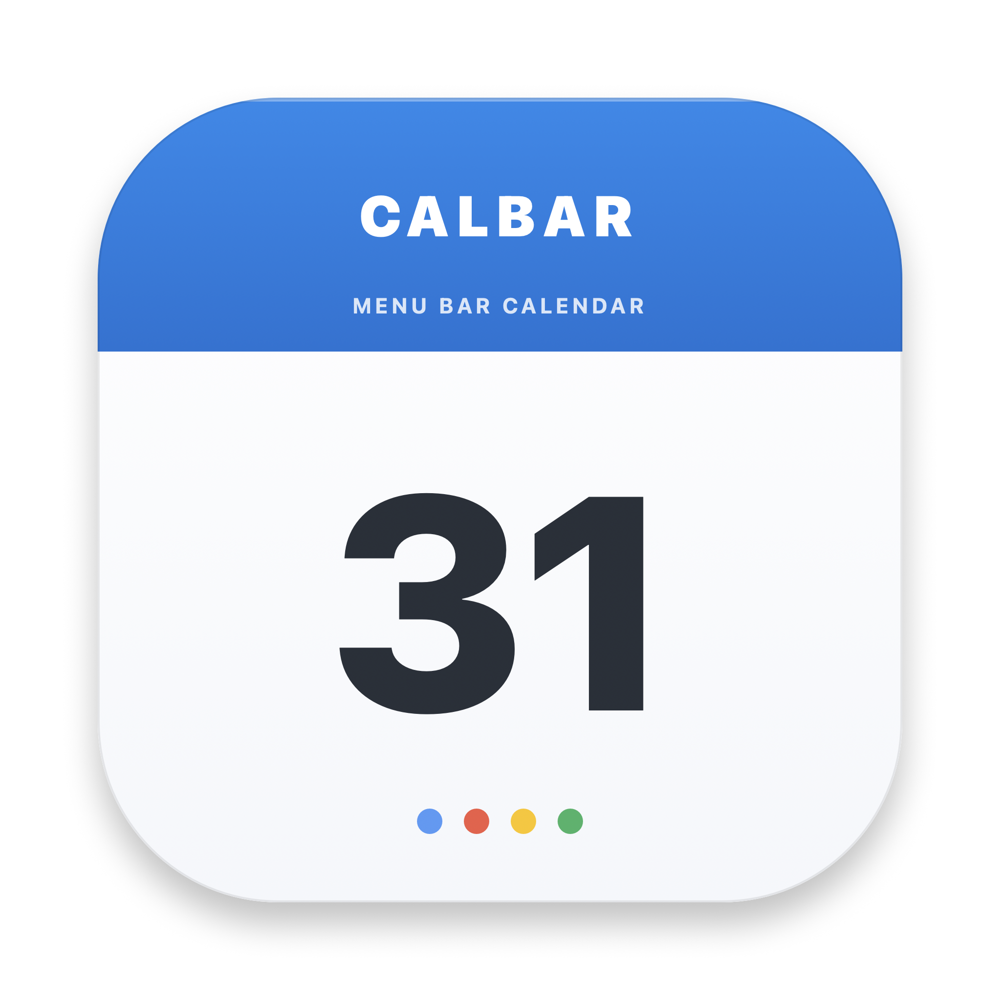

#  CalBar
> A sleek, native macOS menu bar app bringing Google Calendar Day and Week views right to your status bar.


---

## ✨ Features

- **Google Calendar Day View**:
  - Full 24-hour vertical timeline grid with subtle hour guidelines.
  - Smart overlapping events layout algorithm (just like Google Calendar).
  - Live red "now" timeline bar tracking the current minute of the day.
  - Pinned all-day events shelf at the top.
  - Auto-scrolls straight to the current time or 8:00 AM on open.
- **Google Calendar Week View**:
  - 7-day synchronized grid with date headers.
  - Blue highlighted badge for today.
  - Synchronized vertical scroll across all 7 days.
  - Click any day header to quickly jump into that day's Day View.
- **Direct Video Meeting Shortcuts**:
  - "Join" pill button directly inside Google Meet / Zoom events for 1-click meeting access.
  - Rich event detail modal with attendees, location, full descriptions, and "Open in Google Calendar web".
- **Google Calendar Sync**:
  - **macOS System Calendars (Zero Setup)**: Automatically mirrors any Google accounts already signed into macOS *System Settings → Internet Accounts*.
  - **Direct Google Calendar OAuth 2.0 (PKCE)**: Connect straight to Google Calendar API with secure Keychain token storage and transparent token refresh.
  - **Interactive Demo Mode**: Explore the full UI with sample schedules and meetings immediately out of the box.
- **Calendar Filtering & Settings**:
  - Multi-calendar selector in Settings: toggle individual calendars on/off.
  - Color-coded swatches matching Google Calendar palette.
  - Menu bar icon styles: Icon only, Icon + Day of Month (e.g. `10`), or Next Meeting Countdown (e.g. `in 15m: Team Standup`).
  - Customizable background refresh intervals (1 min, 5 min, 15 min, 30 min).
  - Week start day customization (Sunday vs Monday).
  - Clean menu bar accessory lifecycle (`LSUIElement = true`) with automatic click-away dismissal.

---

## 🚀 Quick Start

### Option 1: Install with `CalBar.dmg` (Recommended)
Double-click `CalBar.dmg` in the repository root (or run `open CalBar.dmg`), then drag **CalBar** into **Applications**.

### Option 2: Build as a macOS `.app` bundle
```bash
./scripts/build_app.sh
open CalBar.app
```

### Option 3: Run directly with Swift
```bash
swift run CalBar
```

---

## 🛠️ Architecture

```
CalBar/
├── Package.swift
├── CalBar.dmg                        # Release disk image
├── scripts/
│   ├── build_app.sh                  # Release bundle packager & codesigner
│   ├── build_icon.sh                 # Multi-resolution iconset compiler
│   ├── create_dmg.sh                 # Styled distribution DMG builder
│   ├── generate_icon.swift           # CoreGraphics macOS squircle icon generator
│   └── generate_dmg_background.swift # High-DPI DMG installer background generator
├── Sources/
│   └── CalBar/
│       ├── CalBar.swift              # Main entrypoint & accessory policy
│       ├── App/
│       │   └── MenuBarController.swift # NSStatusItem & NSPopover lifecycle
│       ├── Models/
│       │   ├── AppearanceSettings.swift# Density, past-time shading & scroll models
│       │   ├── CalendarItem.swift     # Calendar model with hex colors
│       │   ├── CalendarEvent.swift    # Event model with duration & Meet links
│       │   └── ViewMode.swift         # Day vs Week view enum
│       ├── Services/
│       │   ├── CalendarSyncCoordinator.swift # State coordinator & timer
│       │   ├── GoogleAuthService.swift       # OAuth 2.0 PKCE & Keychain
│       │   ├── GoogleCalendarService.swift   # Google Calendar v3 REST API
│       │   ├── EventKitService.swift         # Apple EventKit macOS sync
│       │   ├── KeychainManager.swift         # macOS Keychain storage
│       │   └── SampleDataService.swift       # Demo fallback data
│       ├── Utilities/
│       │   ├── DateExtensions.swift          # Date & week arithmetic
│       │   ├── DateFormatterCache.swift      # Sendable static formatter cache
│       │   ├── EventLayoutAlgorithm.swift    # Greedy interval graph coloring
│       │   └── GooglePalette.swift           # Google color palette tokens
│       └── Views/
│           ├── MenuBarPopoverView.swift      # Root popover view
│           ├── Header/
│           │   └── CalendarHeaderView.swift  # Navigation, mode toggle, actions
│           ├── DayView/
│           │   ├── DayGridView.swift         # 24h scrollable schedule
│           │   ├── TimeGutterView.swift      # Hour markers & guidelines
│           │   ├── AllDayEventsShelf.swift   # Pinned all-day cards
│           │   ├── CurrentTimeIndicator.swift# Live red line & circle
│           │   └── TimedEventBlock.swift     # Google Calendar event card
│           ├── WeekView/
│           │   ├── WeekGridView.swift        # 7-day synchronized grid
│           │   └── WeekDayHeader.swift       # 7-day column headers
│           ├── EventDetails/
│           │   └── EventDetailPopover.swift  # Event detail popup
│           └── Settings/
│               ├── SettingsView.swift        # Tabbed settings dialog
│               ├── AccountsSettingsTab.swift # Google OAuth & EventKit
│               ├── CalendarSelectionTab.swift# Calendar visibility checkboxes
│               └── AppearanceSettingsTab.swift # Menu bar display, density & appearance
└── Tests/
    └── CalBarTests/
        └── EventLayoutAlgorithmTests.swift   # Algorithm unit tests
```

---

## 🔒 Security & Privacy

- All OAuth tokens and refresh credentials are saved in the secure macOS Keychain via `Security.framework`.
- Calendar queries remain strictly on your local machine. No analytics or third-party servers are contacted.
